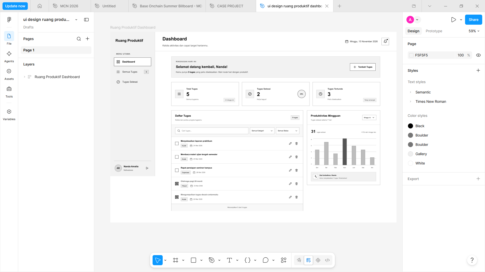
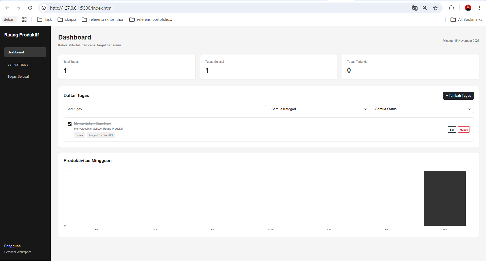
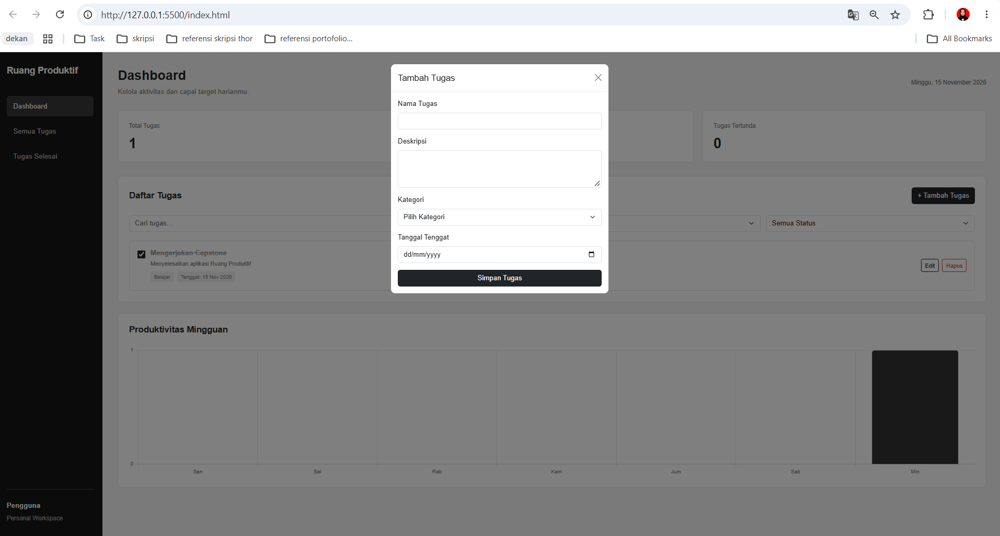
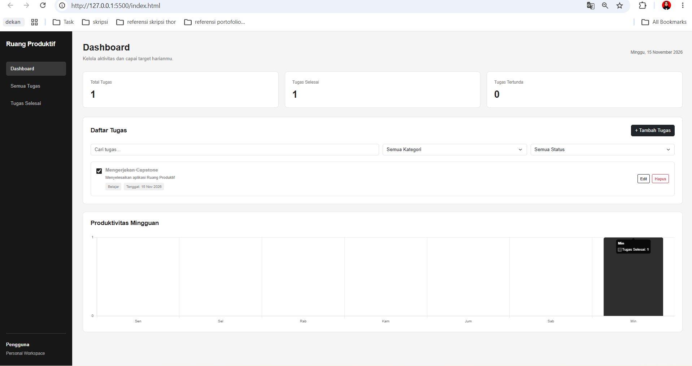
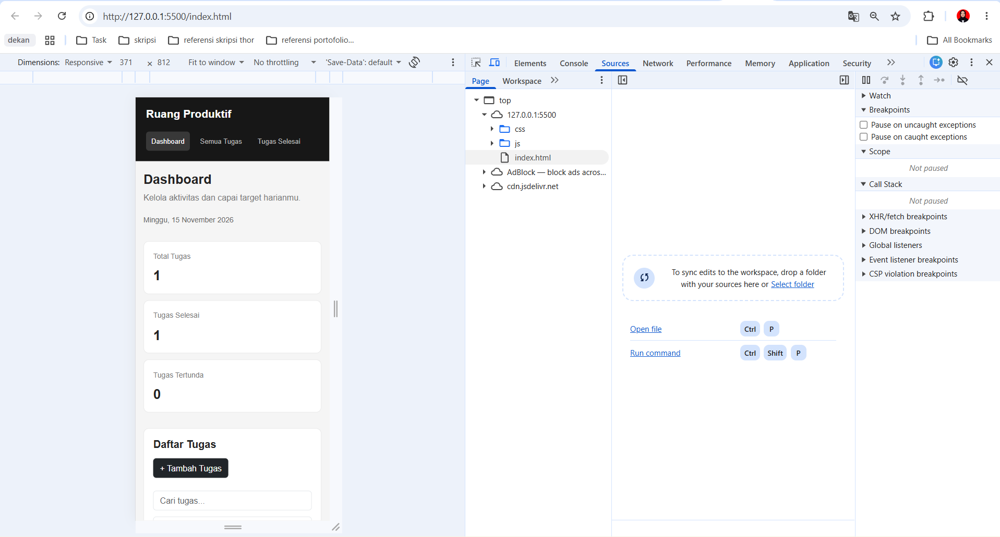

# Ruang Produktif — Productivity Dashboard

Ruang Produktif merupakan aplikasi web sederhana untuk membantu pengguna mengelola tugas dan aktivitas sehari-hari secara terstruktur. Aplikasi ini menyediakan fitur manajemen tugas, pemantauan progres, penyimpanan data lokal, dan visualisasi produktivitas mingguan.

## Preview

### Wireframe Design


### Application Dashboard


### Task Management


### Productivity Chart


### Mobile View


## Features

- Menambahkan tugas baru.
- Mengedit informasi tugas.
- Menghapus tugas.
- Menandai tugas selesai atau belum selesai.
- Mengelompokkan tugas berdasarkan kategori.
- Mencari tugas berdasarkan nama atau deskripsi.
- Memfilter tugas berdasarkan kategori dan status.
- Menampilkan ringkasan jumlah tugas.
- Menyimpan data menggunakan localStorage.
- Menampilkan grafik produktivitas mingguan.

## Technologies

- HTML5
- CSS3
- JavaScript
- Bootstrap 5.3.3
- Chart.js
- SweetAlert2
- Git dan GitHub

## Project Structure

```text
junior-web-programming-capstone/
├── assets/
│   └── wireframe-dashboard.png
├── css/
│   └── style.css
├── js/
│   └── app.js
├── index.html
├── PROJECT-SPEC.md
├── TESTING.md
├── BUG-TRACKING.md
└── README.md
```

## How to Run

1. Clone repository ini.
2. Buka folder proyek menggunakan Visual Studio Code.
3. Pastikan perangkat terhubung ke internet untuk memuat library eksternal melalui CDN.
4. Jalankan file `index.html` menggunakan ekstensi Live Server.
5. Aplikasi akan terbuka di browser.

## Data Storage

Aplikasi menggunakan localStorage pada browser untuk menyimpan data tugas. Data tersimpan pada browser dan perangkat yang digunakan.

## Testing

Pengujian dilakukan terhadap fitur utama aplikasi, meliputi:

- Functional testing.
- CRUD testing.
- Search and filter testing.
- localStorage testing.
- Responsive testing pada mobile, tablet, dan desktop.

Dokumentasi pengujian tersedia pada file `TESTING.md`.

## Project Purpose

Proyek ini dikembangkan sebagai Capstone Project dalam pembelajaran Junior Web Programming untuk mengintegrasikan kompetensi pengembangan aplikasi web dari tahap perencanaan, implementasi, integrasi library, debugging, hingga pengujian dan dokumentasi.